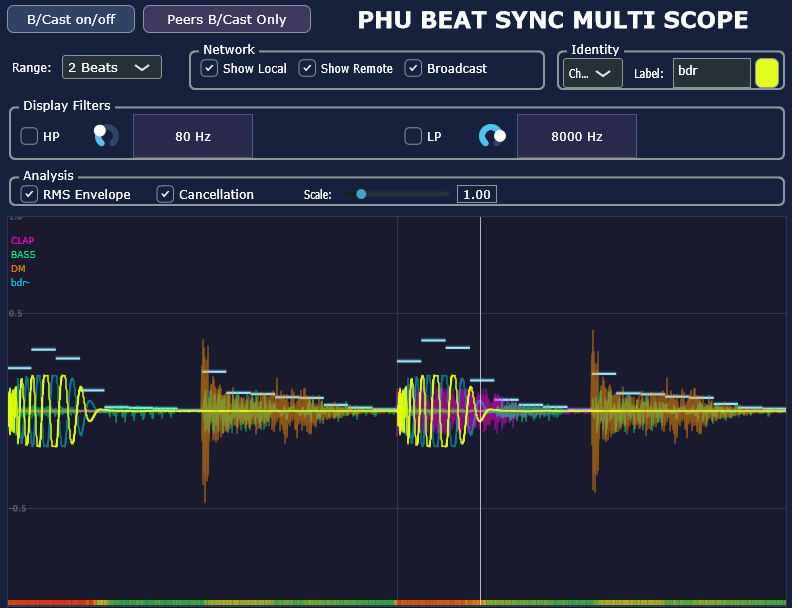
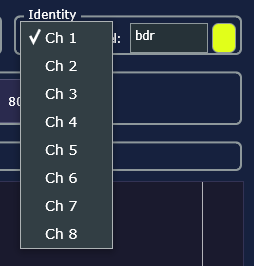
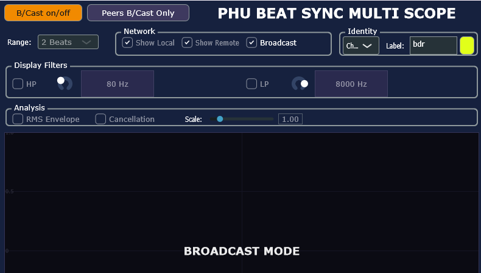
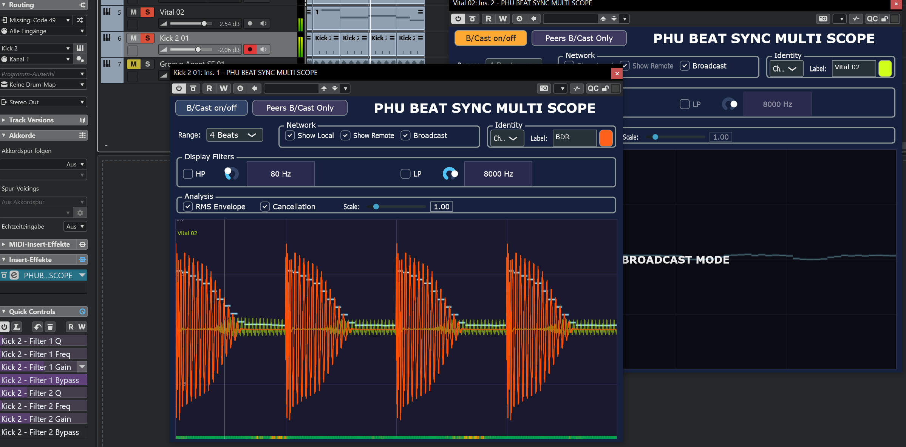

# PHU Beat Sync Multi Scope

[](https://github.com/huberp/phu-beat-sync-multi-scope/actions/workflows/build.yml)
[](https://github.com/huberp/phu-beat-sync-multi-scope/actions/workflows/release.yml)
[](LICENSE)
[](CONTRIBUTING.md#building)
[-purple.svg)](CONTRIBUTING.md#building)
[](CONTRIBUTING.md#building)
[](https://juce.com)
[](https://ko-fi.com/phuplugins)

A beat-synced oscilloscope that you load on several DAW tracks at once. Every instance draws the same musical window (1, 2, 4 or 8 beats), and the instances share their waveforms with each other in real time, so you can compare phase, level and transient alignment across tracks in a single display. The plugin is a pure analyser: audio passes through unchanged and no latency is added. Available as VST3 (Windows, Linux, macOS) and AU (macOS).



---

## Contents

- [Highlights](#highlights)
- [User Guide](#user-guide)
  - [Installation](#installation)
  - [Quick Start](#quick-start)
  - [Controls](#controls)
  - [Reading the Display](#reading-the-display)
  - [Usage Scenarios — Where to Place It](#usage-scenarios--where-to-place-it)
  - [Limitations and Good to Know](#limitations-and-good-to-know)
- [Cancellation Detector](#cancellation-detector)
- [Building and Architecture](#building-and-architecture)
- [License](#license)

---

## Highlights

🎯 **Beat-locked across every instance** — samples are stored at their absolute PPQ position, not in arrival order. Every instance draws the same beat grid regardless of display range, network jitter, or when it joined the session. A kick on beat 1 sits at the same x position in every trace.

🔊 **Pure analyser** — the audio passes through untouched, the plugin reports no latency, and it can be inserted anywhere in a signal chain without changing the sound.

📡 **Two-channel peer protocol** — a sample channel (UDP multicast, port 49422) streams beat-aligned mono waveforms between instances. A separate control channel (port 49423) carries per-instance identity, heartbeats, colours, and display-range metadata. Instances find each other automatically: no server, no pairing, no configuration.

🔇 **Headless broadcast** — a broadcasting instance keeps sending when its plugin window is closed. Its CPU overhead is minimal.

⚡ **Broadcast-only mode** — instances that only feed data to others can switch off all display work, and a single "viewer" instance can put all its peers into this mode with one click.

🎨 **Per-instance identity** — each instance carries a channel number (Ch 1–8), a free-text label and a colour. Remote traces are drawn in their own colour with their label, so multi-track comparison is readable at a glance.

🎚️ **Display-path filtering** — 48 dB/oct Linkwitz-Riley high-pass and low-pass filters are applied only to what you see, never to the audio. Isolate a frequency band without touching the mix.

📈 **Beat-grid RMS envelope** — step lines at every 1/16 note show how much energy each part of the bar carries.

🔬 **Phase cancellation detector** — a fine-grained colour bar (about 4 ms resolution at short ranges) shows how much the instances cancel each other, level-weighted to suppress noise-floor artefacts. See [Cancellation Detector](#cancellation-detector).

🖥️ **GPU-accelerated rendering** — waveforms, grid, playhead and the analysis overlays are drawn with OpenGL, with an automatic software fallback if OpenGL is unavailable.

---

## User Guide

### Installation

1. Download the latest release from [Releases](https://github.com/huberp/phu-beat-sync-multi-scope/releases). Release zips are provided for Windows x64, Windows ARM64, Linux x64, macOS Intel and macOS Apple Silicon.
2. Copy the plugin bundle to your DAW's plugin folder:
   - Windows: `C:\Program Files\Common Files\VST3\` (`.vst3`)
   - Linux: `~/.vst3/` or `/usr/lib/vst3/` (`.vst3`)
   - macOS AU: `~/Library/Audio/Plug-Ins/Components/` (`.component`)
   - macOS VST3: `~/Library/Audio/Plug-Ins/VST3/` (`.vst3`)
3. Rescan plugins in your DAW
4. Load **PHU BEAT SYNC MULTI SCOPE** on every track you want to compare

**Windows:** Requires the [Microsoft Visual C++ 2015–2022 Redistributable (x64)](https://aka.ms/vs/17/release/vc_redist.x64.exe). Already present if Visual Studio 2019 or 2022 is installed.  
**Linux:** No external dependencies — the binary is self-contained.  
**macOS Intel:** Download the `macos-x64` release for Mac computers with an Intel processor.  
**macOS Apple Silicon:** Download the `macos-arm64` release for Mac computers with an M-series chip.

The plugin is **stereo in / stereo out**. It mixes the input to mono for display and broadcasting, and supports sample rates from 44.1 kHz up to 192 kHz and tempos from 40 BPM upwards. To build from source, see [CONTRIBUTING.md](CONTRIBUTING.md#building).

### Quick Start

1. Load the plugin on two or more tracks that play in the same project.
2. **Give every instance its own channel number** (Ch 1–8) in the *Identity* group. New instances all start on Ch 1, and an instance ignores peers that use its own channel number.
3. Optionally type a **label** (for example "Kick") and pick a **colour** for each instance.
4. Enable **Broadcast** on every instance that should share its signal. **Show Remote** is on by default, so all instances now appear in each other's display.
5. Start playback. Traces appear as the playhead passes over them.
6. Turn on **Cancellation** to see where two tracks work against each other, and use the **HP / LP** filters to look at a single frequency band.

```
Track 1  →  [plugin]  Ch 1  "Kick"   Broadcast ✔  Show Remote ✔
Track 2  →  [plugin]  Ch 2  "Snare"  Broadcast ✔  Show Remote ✔
Track 3  →  [plugin]  Ch 3  "Bass"   Broadcast ✔  Show Remote ✔
```

All instances see each other automatically. Broadcasting continues when a plugin window is closed. The **Broadcast** switch is off by default and is saved with the project, as are the label, colour and channel.

### Controls

**Title bar**

| Control | Function |
|---|---|
| B/Cast on/off | Broadcast-only mode. The scope display and all display computation are switched off to free CPU, the instance keeps sending. Use it on instances that only feed data to a viewer. |
| Peers B/Cast Only | Sends a command that puts every other instance into broadcast-only mode. Use it on the one instance you are looking at. To bring a peer back, open its window and switch off **B/Cast on/off**. |
| Range | Beat window shown: 1, 2, 4 or 8 beats. At low tempos the wider ranges are greyed out and the selection steps down automatically (below 80 BPM: max 4 beats, below 60 BPM: max 2 beats, below 40 BPM: 1 beat). |

**Network group**

| Control | Function |
|---|---|
| Show Local | Hide or show this instance's own waveform |
| Show Remote | Hide or show all waveforms received from other instances. Also switches the receiving of remote data on or off. |
| Broadcast | Enable or disable sending this instance's waveform to the others |

**Identity group**

Each instance gets a channel number (Ch 1–8), a free-text label (up to 31 characters) and a colour. These are sent to all peers, which use them to place, label and colour the overlaid waveforms. The channel number selects the display slot, so it has to be unique among the instances that talk to each other. Click the colour swatch to change the colour.



**Display Filters group**

High-pass and low-pass filters (48 dB/oct) applied only to the display signal — the audio path is unaffected. Each strip has an enable switch and a frequency control. The high-pass frequency is always kept below the low-pass frequency. The filter settings are automatable DAW parameters and apply to the local and all remote traces.

**Analysis group**

| Control | Function |
|---|---|
| RMS Envelope | Step lines at every 1/16 note showing the RMS level |
| Cancellation | Colour bar at the bottom of the scope showing phase cancellation between instances |
| Scale | Vertical zoom of the display (0.5× – 4×). Double-click to reset to 1×. |



*In broadcast-only mode the scope display is replaced by a status overlay. All display computations stop, reducing the CPU impact for instances that only need to feed data to others.*

### Reading the Display

- **Horizontal axis — musical time.** The whole width is one window of 1, 2, 4 or 8 beats. Vertical grid lines mark the beats. The position is derived from the DAW's PPQ, so the same musical moment is always at the same x position, in every instance and in every pass through the loop.
- **Vertical axis — linear amplitude.** The grid shows ±1, ±0.5 and 0 (full scale at the top and bottom). Use **Scale** to zoom in on quiet material.
- **White vertical line — the playhead.** It sweeps from left to right through the window. The trace to its left was just written; the trace to its right is still from the previous pass and is overwritten as the playhead moves on.
- **Full-strength trace — the local instance**, drawn in its own colour on top.
- **Half-transparent traces — remote instances**, each in its own colour with its label in the top-left corner. Because all traces share the beat grid, you can compare transients, onsets and polarity by eye: a drum hit should start at the same x position on every track that carries it.
- **Light-blue step lines — RMS envelope.** One line per 1/16 note, positioned at the RMS level on the same vertical scale as the waveform. With remote instances shown, the height is the sum of the individual RMS levels of all instances; otherwise it is the local RMS. Use it to see which sixteenths of the bar carry the energy.
- **Coloured bar at the bottom — cancellation.** Green means the instances add up as expected, yellow shows partial cancellation, red shows heavy cancellation. It appears only while at least two instances are active and **Show Remote** is on. Details and typical values are in [Cancellation Detector](#cancellation-detector).
- **"BROADCAST MODE" overlay** — this instance is in broadcast-only mode and does not draw.

### Usage Scenarios — Where to Place It

The scope shows the signal at its insert point and passes it on unchanged, so you decide what you are looking at by where you put it. Insert it **after** the processing you want to judge (EQ, compressor, time-shifting, polarity flip) and remember that a pre-fader insert does not see fader moves.



*Two instances in Cubase: the front window is the viewer on the kick track (orange, label "BDR") that also shows the green remote trace "Vital 02", the window behind it is the "Vital 02" instance in broadcast-only mode. The RMS step lines and the cancellation bar at the bottom are switched on.*

| Scenario | Placement | What to look at |
|---|---|---|
| **Polarity and phase of multi-mic sources** (snare top/bottom, kick in/out, DI + amp mic, stereo overheads) | One instance on each mic track, unique channels and labels | Do the first transients start in the same direction? Switch on **Cancellation** and flip the polarity of one track: a red bar that turns green means you found the better setting. |
| **Kick and bass** | One instance on the kick track, one on the bass track. Set **LP** to about 120 Hz on either instance | The low-frequency waves of both instruments on one beat grid. Red regions in the cancellation bar mark where they fight. The RMS envelope shows how their energy is distributed over the bar. |
| **Layered or sample-replaced drums** | One instance on every layer | Do the layers start on the same sample? Early or late layers show up as shifted onsets across the traces. |
| **Parallel processing and delay compensation** (dry vs. compressed or saturated copy, plugins with latency) | One instance on the dry channel, one on the parallel channel, both after the processing | Time-offset copies appear shifted against each other and produce coloured cancellation. Use it to verify that your DAW's plugin delay compensation is doing its job. |
| **Timing and groove check** | A single instance on the track, **Show Remote** off | The waveform on the beat grid, with the RMS envelope per 1/16 note. Useful for checking if a part is on the grid or pushed or pulled. |
| **Mix overview** | One instance on the master or a group bus as the **viewer**, **Peers B/Cast Only** on, all other instances broadcasting | One window that shows all tracks together and keeps the CPU cost on the other tracks low. |

Practical tips:

- Use **one viewer instance** and put the others into broadcast-only mode (via **Peers B/Cast Only** or their own **B/Cast on/off**). Only an instance with an open window needs to draw.
- Keep the **Range** short (1 or 2 beats) when you look at phase and transients, and long (4 or 8 beats) when you look at groove and energy distribution.
- Compare tracks at equal level. The cancellation index is level-weighted, so very quiet passages show little.
- Closing a plugin window does not stop an instance from broadcasting.

### Limitations and Good to Know

- **Same computer only.** The instances exchange data by UDP multicast with a TTL of 1 on `239.255.42.1`, and the sample packets are larger than a network MTU. Sharing between different machines is not supported.
- **At most 8 instances** (1 local + 7 remote), one per channel number. Instances on the same channel number do not see each other.
- **The host must report tempo and position.** The display is positioned by the DAW's PPQ and BPM. Without a tempo the plugin does not collect data.
- **Firewall.** Local multicast on UDP ports 49422 and 49423 must not be blocked. If instances do not see each other, check the firewall of your OS or security software.
- **Silent peers disappear.** A remote instance that has not sent for 3 seconds is removed from the display, and it reappears as soon as it sends again.
- **Mono analysis.** The two input channels are averaged to one mono signal, so content that is out of phase between left and right cancels before it is displayed.
- **Debug builds** contain an additional log panel below the scope. Release builds do not.

---

## Cancellation Detector

The cancellation detector compares the level of the combined signal of all active instances with the level it would have if all instances were perfectly in phase. It is a direct indicator of phase cancellation across tracks.

### Formula

For each time window, the raw cancellation index is:

$$CI = 1 - \frac{\text{RMS}(L + R_1 + R_2 + \cdots)}{\text{RMS}(L) + \text{RMS}(R_1) + \text{RMS}(R_2) + \cdots}$$

The denominator is the maximum possible RMS of the sum, reached if every instance were perfectly in phase (triangle inequality). $CI \in [0, 1]$: 0 = the signals add up fully in phase, 1 = total cancellation.

### What Values to Expect

The reference is the *in-phase* sum, so even unrelated signals do not reach 0. Two uncorrelated signals of equal level give $CI \approx 0.29$, three give $CI \approx 0.42$. A mix of different instruments therefore typically sits in the green-to-yellow range. Values towards **red** appear when signals are truly out of phase: the same source captured by two microphones, one of them in reversed polarity or shifted by a fraction of a period.

Compare before/after instead of reading absolute values: flip a polarity, nudge a time offset, and watch the bar change.

### Level Weighting

$CI$ values near the noise floor are suppressed to avoid false readings on near-silent signals:

$$CI_w = CI \cdot \sqrt{\min\!\left(1,\;\frac{D}{D_{\text{ref}}}\right)}$$

where $D = \text{RMS}(L) + \sum \text{RMS}(R_i)$ and $D_{\text{ref}} = 0.1$ (≈ −20 dBFS).

| $D$ | Weight | Effect |
|---|---|---|
| 0.01 (−40 dBFS) | 0.32 | Strongly suppressed |
| 0.03 (−30 dBFS) | 0.55 | Moderately suppressed |
| ≥ 0.10 (−20 dBFS) | 1.00 | Full CI displayed |

Windows with $D \le 10^{-4}$ (≈ −80 dBFS) are skipped and shown as no cancellation.

### Colour Mapping

| $CI_w$ | Colour | Meaning |
|---|---|---|
| 0.0 | `#00BB55` green | In-phase |
| 0.4 | `#FFCC00` yellow | Partial cancellation |
| 1.0 | `#FF3300` red | Total cancellation |

Values in between are interpolated.

### Resolution

Each window covers about 4 ms, up to a maximum of 256 windows across the display range. Short ranges therefore get the full 4 ms resolution; longer ranges are divided into 256 equal windows:

$$\Delta t \approx \max\!\left(4\ \text{ms},\ \frac{60}{\text{BPM}} \cdot \frac{R}{256}\ \text{s}\right)$$

where $R$ is the range in beats. At 120 BPM: 1 or 2 beats → 4 ms, 4 beats → about 7.8 ms, 8 beats → about 15.6 ms.

---

## Building and Architecture

Build instructions for Windows, Linux and macOS, the project layout, the architecture, the network protocol and the CI workflows are described in [CONTRIBUTING.md](CONTRIBUTING.md).

---

## License

[MIT](LICENSE)
